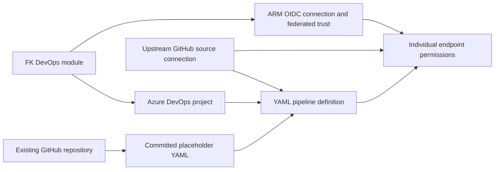

# Example 01: Pipeline Definition with GitHub Source

In this first Azure Pipelines example, we register a **GitHub-sourced YAML pipeline definition** using **Terraform / OpenTofu**.

The example composes **terraform-az-fk-devops** with the local pipeline module. Shared project and ARM federation resources are created upstream; an optional GitHub PAT source connection is created by the upstream module.

---

## 🧭 Architecture Overview

The pipeline definition points at `azure-pipelines.yml` on the `master` branch of [foggykitchen-hello-world](https://github.com/foggykitchen/foggykitchen-hello-world). Separate endpoint permissions allow this pipeline to use the GitHub source connection and the upstream ARM OIDC connection.



This example creates:

- One Azure DevOps project through `terraform-az-fk-devops`
- One Entra application/service principal, ARM WIF connection and federated credential through the upstream module
- One Azure Resource Group in `resource_group.tf`
- One YAML pipeline definition through the local `terraform-az-fk-devops-pipeline` module
- Individual pipeline permissions for the upstream GitHub source endpoint and upstream ARM endpoint

The organization, subscription and GitHub repository already exist. The GitHub endpoint is created through the upstream module. No source repository, Azure role assignment, networking or deployment target is created.

**Stages, jobs, steps and trigger logic remain in YAML.** The local `azure-pipelines.yml` is a reference copy of the minimal placeholder in the source repository, with CI and PR triggers disabled and a single `Hello World` echo step. The definition reads the remote file, not this local copy. It contains no OpenTofu plan/apply or OIDC login logic and does not use the ARM connection.

---

## 🎯 Why this example exists

Before introducing shared configuration, it is useful to understand **how the project, source connection, YAML path and pipeline permissions fit together**.

This example focuses on:

- Registering a YAML definition without modeling its stage graph
- Passing upstream `project_id` and `service_connection_id` outputs
- Separating GitHub source access from ARM workload authentication
- Authorizing only the registered pipeline to use each endpoint
- Referencing a committed repository-relative YAML path

---

## 🚀 Deployment Steps

### Prerequisites

- An existing Azure DevOps organization and subscription
- Rights to create projects, ARM connections and pipeline definitions, and to manage individual pipeline resource permissions
- Entra rights to create/manage applications, service principals and federated credentials
- Bootstrap authentication configured externally for the AzureDevOps, AzureAD and AzureRM providers
- Permission to create the example Resource Group in the selected subscription
- A GitHub PAT with source access, supplied through `AZDO_GITHUB_SERVICE_CONNECTION_PAT` in the execution environment
- The placeholder YAML published on the repository's selected remote branch

Copy `terraform.tfvars.example` to ignored `terraform.tfvars` and replace the nonsecret placeholder identifiers. Keep provider credentials outside HCL and tfvars. The upstream GitHub endpoint and ARM endpoint identify different resources. The GitHub provider stores its PAT in state, including when read from the environment; secure the state and never commit credentials.

### Stage 1 — Prepare source credentials and YAML

The upstream dependency in `devops.tf` is pinned to commit `25a5eca15641c81b23cad6d0a1d84330bc634dbf`, released as [terraform-az-fk-devops v0.2.0](https://github.com/foggykitchen/terraform-az-fk-devops/releases/tag/v0.2.0). Configure the GitHub PAT externally through `AZDO_GITHUB_SERVICE_CONNECTION_PAT`. The example requests `hello_world = { name = "fk-github-hello-world" }` from the upstream module; its `github_service_connection_ids["hello_world"]` output feeds the pipeline repository block.

The upstream module owns GitHub source endpoint creation. Terraform orders project creation, GitHub connection creation, pipeline registration and individual authorization. Existing foundation resources remain at the same resource addresses in the local state.

The referenced `azure-pipelines.yml` must exist on `master` in `foggykitchen/foggykitchen-hello-world`. A local file or commit alone does not publish YAML to the source repository.

### Stage 2 — Validate the pipeline configuration

From this example directory:

```bash
cp terraform.tfvars.example terraform.tfvars
# Replace the nonsecret placeholder identifiers before deployment.
tofu init -backend=false
tofu fmt -check
tofu validate
```

`devops.tf` composes the upstream module at the reviewed v0.2.0 commit. `pipeline.tf` uses the local root module source `../..`. `providers.tf`, `variables.tf` and `outputs.tf` provide the example wrapper. The pipeline definition suppresses its initial automatic run.

Both the foundation stage and the full configuration have been deployed successfully. Terraform created the GitHub source connection, registered the pipeline and authorized its endpoint access. The example creates its Resource Group using `resource_group_name` and `location`; `resource_group_id` is an external composition point. The ARM connection grants no Azure RBAC; compose the dedicated RBAC module externally when a future workload needs subscription access.

---

## 🖼️ Azure DevOps Portal View

The project, ARM WIF trust, Resource Group, GitHub connection and pipeline permissions have been deployed. Test run #1 succeeded. No screenshots have been collected yet.

After an authorized deployment, inspect the project’s **Pipelines** view for `fk-pipeline-01`, its GitHub repository, selected branch and YAML path. Inspect **Project settings → Service connections → Pipeline permissions** for both endpoint grants.

Portal configuration evidence should be recorded separately from a successful pipeline run or OIDC token exchange.

---

## ✅ Test Results

Static verification completed on **October 14, 2026** with OpenTofu **1.11.6**:

| Check | Result |
|---|---|
| `tofu fmt -check` | Passed |
| `tofu init -backend=false` | Passed |
| `tofu validate` | Passed |
| Placeholder YAML syntax | Passed |

Initial verification used static checks only. A subsequent user-authorized foundation apply on **October 14, 2026** completed successfully:

```text
Apply complete! Resources: 6 added, 0 changed, 0 destroyed.
```

This bootstrap created the project, Entra application/service principal, ARM WIF connection, federated credential and Resource Group. It targeted only `module.devops` and `azurerm_resource_group.foggykitchen_rg` because the GitHub source endpoint must be registered in the new project before the pipeline can be created. A subsequent full apply completed successfully:

```text
Apply complete! Resources: 4 added, 0 changed, 0 destroyed.
```

The full apply added the GitHub service connection, YAML pipeline definition and two individual endpoint authorizations. The example now manages **10 resources**. API inspection confirmed GitHub repository `foggykitchen/foggykitchen-hello-world`, branch `master`, YAML path `azure-pipelines.yml`, and access for pipeline ID `1` to both ARM and GitHub endpoints without all-pipeline grants.

[Pipeline run #1](https://dev.azure.com/foggykitchendevops/fk-pipeline-01/_build/results?buildId=1) completed with **succeeded**. GitHub checkout and the **Hello World** step both succeeded. This confirms source authentication, remote YAML loading and placeholder execution. The run does not use the ARM connection, so runtime OIDC token exchange remains untested.

The hosted agent reported a warning about the upcoming `ubuntu-latest` image migration; it did not prevent the test from succeeding.

Static checks validate configuration and provider schema; they do not verify remote YAML availability or runtime permissions.

The example outputs expose `project_id`, `service_connection_id`, `pipeline_id` and `resource_group_id`. The pipeline ID output waits for its endpoint and variable-group permission resources. This establishes dependency ordering, not a guarantee of runtime readiness.

---

## 🧹 Cleanup

The two applies created ten managed resources in total. They remain deployed for screenshots and inspection; cleanup has not been performed.

After a future deployment, review project contents and source-connection ownership before destroying the example. The configuration manages the project, Entra identity, ARM connection, federated trust, Resource Group, GitHub connection, pipeline definition and its individual permissions. Review Resource Group contents before deletion. Project deletion can also remove contents added independently. The GitHub source endpoint is now owned by the upstream module in this example’s state. The GitHub repository, Azure DevOps organization and Azure subscription remain externally managed.

---

## 🪪 License

Licensed under the **Universal Permissive License (UPL), Version 1.0**.
See [LICENSE](../../LICENSE) for details.

---

© 2026 [FoggyKitchen.com](https://foggykitchen.com) - Cloud. Code. Clarity.
