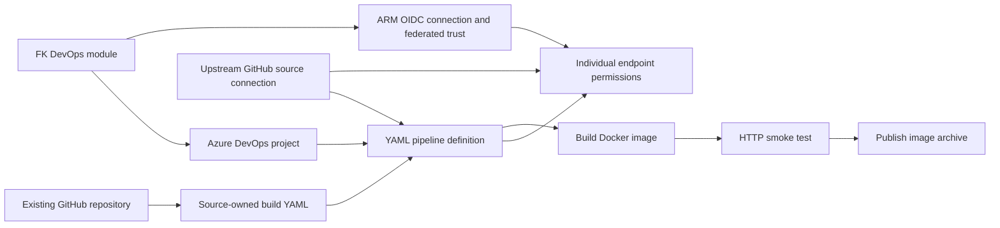
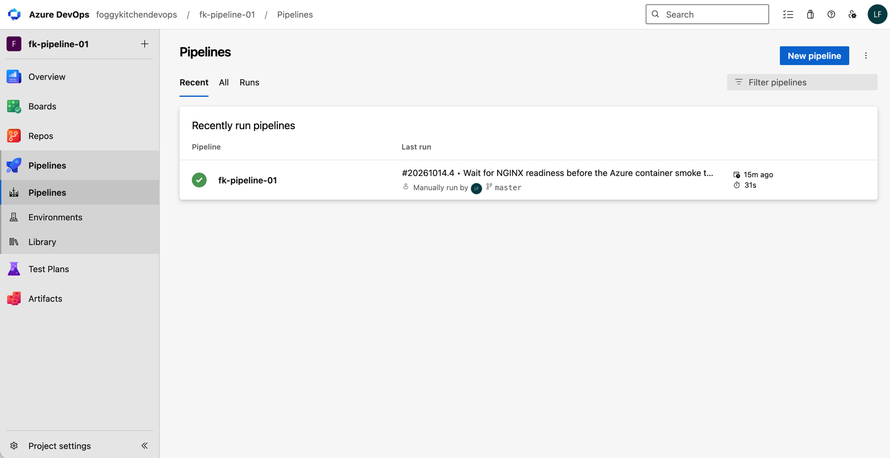
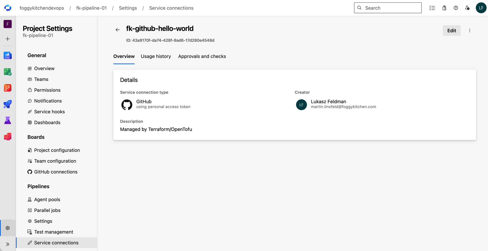
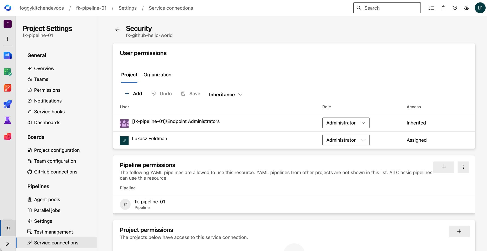
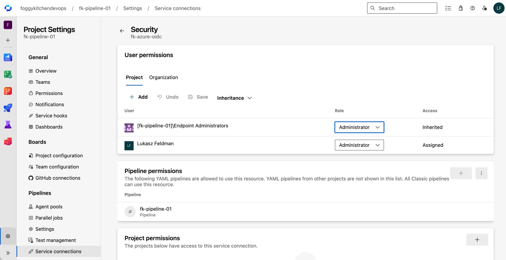
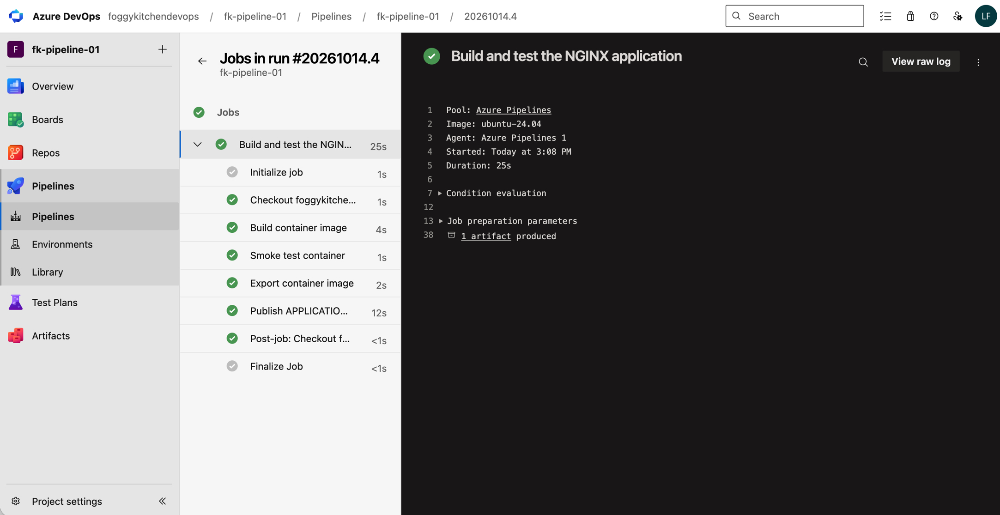
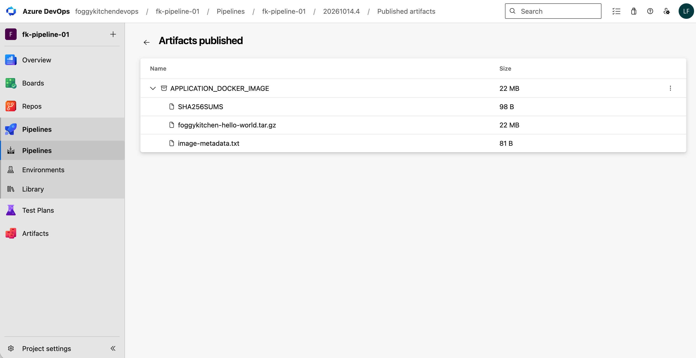

# Example 01: Container Build with GitHub Source

In this first Azure Pipelines example, we register a **GitHub-sourced YAML pipeline definition for building and testing the NGINX application** using **Terraform / OpenTofu**.

The example composes **terraform-az-fk-devops** with the local pipeline module. Shared project and ARM federation resources are created upstream; an optional GitHub PAT source connection is created by the upstream module.

---

## 🧭 Architecture Overview

The pipeline definition points at `azure-pipelines.yml` on the `master` branch of [foggykitchen-hello-world](https://github.com/foggykitchen/foggykitchen-hello-world). Separate endpoint permissions allow this pipeline to use the GitHub source connection and the upstream ARM OIDC connection.



This example creates:

- One Azure DevOps project through `terraform-az-fk-devops`
- One Entra application/service principal, ARM WIF connection and federated credential through the upstream module
- One Azure Resource Group in `resource_group.tf`
- One YAML pipeline definition through the local `terraform-az-fk-devops-pipeline` module
- Individual pipeline permissions for the upstream GitHub source endpoint and upstream ARM endpoint

The organization, subscription and GitHub repository already exist. The GitHub endpoint is created through the upstream module. No source repository, Azure role assignment, networking or deployment target is created.

**Stages, jobs, steps and trigger logic remain in caller-owned YAML.** The local `azure-pipelines.yml` is the reference build configuration for the source repository. Terraform registers only the path; it does not write the source file or turn build steps into resource attributes. The YAML contains no OpenTofu plan/apply or OIDC login logic.

The build workflow performs:

1. Checkout of `foggykitchen-hello-world` from GitHub.
2. Docker build from the repository’s existing Dockerfile, tagged with the Azure DevOps build ID.
3. A temporary NGINX container and HTTP smoke test comparing the served page with `src/index.html`.
4. Export of the image as `foggykitchen-hello-world.tar.gz`, with checksum and image/commit metadata.
5. Publication of `APPLICATION_DOCKER_IMAGE` as a downloadable Azure Pipeline Artifact.

This provides the build/output progression of the OCI example through Azure YAML. Registry publication, deployment stages and ARM runtime authentication are separate workloads. The job uses `ubuntu-24.04`, has a 15-minute timeout and keeps CI/PR triggers disabled for deliberate manual tests.

---

## 🎯 Why this example exists

Before introducing shared configuration, it is useful to understand **how the project, source connection, YAML path and pipeline permissions fit together**.

This example focuses on:

- Registering a YAML definition without modeling its stage graph
- Building and smoke-testing the actual NGINX container through source-owned YAML
- Producing a downloadable image archive for later consumers
- Passing upstream `project_id` and `service_connection_id` outputs
- Separating GitHub source access from ARM workload authentication
- Authorizing only the registered pipeline to use each endpoint
- Referencing a committed repository-relative YAML path

---

## 🚀 Deployment Steps

### Prerequisites

- An existing Azure DevOps organization and subscription
- Rights to create projects, ARM connections and pipeline definitions, and to manage individual pipeline resource permissions
- Entra rights to create/manage applications, service principals and federated credentials
- Bootstrap authentication configured externally for the AzureDevOps, AzureAD and AzureRM providers
- Permission to create the example Resource Group in the selected subscription
- A GitHub PAT with source access, supplied through `AZDO_GITHUB_SERVICE_CONNECTION_PAT` in the execution environment
- The placeholder YAML published on the repository's selected remote branch

Copy `terraform.tfvars.example` to ignored `terraform.tfvars` and replace the nonsecret placeholder identifiers. Keep provider credentials outside HCL and tfvars. The upstream GitHub endpoint and ARM endpoint identify different resources. The GitHub provider stores its PAT in state, including when read from the environment; secure the state and never commit credentials.

### Stage 1 — Prepare source credentials and YAML

The upstream dependency in `devops.tf` is pinned to commit `25a5eca15641c81b23cad6d0a1d84330bc634dbf`, released as [terraform-az-fk-devops v0.2.0](https://github.com/foggykitchen/terraform-az-fk-devops/releases/tag/v0.2.0). Configure the GitHub PAT externally through `AZDO_GITHUB_SERVICE_CONNECTION_PAT`. The example requests `hello_world = { name = "fk-github-hello-world" }` from the upstream module; its `github_service_connection_ids["hello_world"]` output feeds the pipeline repository block.

The upstream module owns GitHub source endpoint creation. Terraform orders project creation, GitHub connection creation, pipeline registration and individual authorization. Existing resources remain at the same addresses in local state. Updating only the source YAML requires a new pipeline run, not a replacement of the Terraform definition.

The referenced `azure-pipelines.yml` must exist on `master` in `foggykitchen/foggykitchen-hello-world`. A local file or commit alone does not publish YAML to the source repository.

### Stage 2 — Validate the pipeline configuration

From this example directory:

```bash
cp terraform.tfvars.example terraform.tfvars
# Replace the nonsecret placeholder identifiers before deployment.
tofu init -backend=false
tofu fmt -check
tofu validate
```

`devops.tf` composes the upstream module at the reviewed v0.2.0 commit. `pipeline.tf` uses the local root module source `../..`. `providers.tf`, `variables.tf` and `outputs.tf` provide the example wrapper. The pipeline definition suppresses its initial automatic run.

Both the foundation stage and the full configuration have been deployed successfully. Terraform created the GitHub source connection, registered the pipeline and authorized its endpoint access. The example creates its Resource Group using `resource_group_name` and `location`; `resource_group_id` is an external composition point. The ARM connection grants no Azure RBAC; compose the dedicated RBAC module externally when a future workload needs subscription access.

---

## 🖼️ Azure DevOps Portal View

The project, ARM WIF trust, Resource Group, GitHub connection and pipeline permissions have been deployed. Connectivity run #1 and container build #4 succeeded.



*Figure 1. Azure DevOps Pipelines view showing fk-pipeline-01 and its successful manual build #20261014.4 on master, with a 31-second execution time.*



*Figure 2. Overview of the fk-github-hello-world service connection created through the upstream DevOps module, using token-based GitHub authentication. The credential value is not displayed.*



*Figure 3. Security view of fk-github-hello-world showing fk-pipeline-01 in the connection’s Pipeline permissions list.*



*Figure 4. Security view of fk-azure-oidc showing fk-pipeline-01 in the ARM connection’s Pipeline permissions list.*



*Figure 5. Successful build #20261014.4 on ubuntu-24.04, showing checkout, container build, HTTP smoke test, image export and artifact publication.*



*Figure 6. APPLICATION_DOCKER_IMAGE published by run #20261014.4, containing the 22 MB image archive, SHA256SUMS and image-metadata.txt.*

After an authorized deployment, inspect the project’s **Pipelines** view for `fk-pipeline-01`, its GitHub repository, selected branch and YAML path. Inspect **Project settings → Service connections → Pipeline permissions** for both endpoint grants.

Portal configuration evidence should be recorded separately from a successful pipeline run or OIDC token exchange.

---

## ✅ Test Results

Static verification completed on **October 14, 2026** with OpenTofu **1.11.6**:

| Check | Result |
|---|---|
| `tofu fmt -check` | Passed |
| `tofu init -backend=false` | Passed |
| `tofu validate` | Passed |
| YAML and build-script syntax | Passed |

Initial verification used static checks only. A subsequent user-authorized foundation apply on **October 14, 2026** completed successfully:

```text
Apply complete! Resources: 6 added, 0 changed, 0 destroyed.
```

This bootstrap created the project, Entra application/service principal, ARM WIF connection, federated credential and Resource Group. It targeted only `module.devops` and `azurerm_resource_group.foggykitchen_rg` because the GitHub source endpoint must be registered in the new project before the pipeline can be created. A subsequent full apply completed successfully:

```text
Apply complete! Resources: 4 added, 0 changed, 0 destroyed.
```

The full apply added the GitHub service connection, YAML pipeline definition and two individual endpoint authorizations. The example now manages **10 resources**. API inspection confirmed GitHub repository `foggykitchen/foggykitchen-hello-world`, branch `master`, YAML path `azure-pipelines.yml`, and access for pipeline ID `1` to both ARM and GitHub endpoints without all-pipeline grants.

Pipeline run #1 completed with **succeeded**. GitHub checkout and the **Hello World** step both succeeded. This confirms source authentication, remote YAML loading and placeholder execution. The run does not use the ARM connection, so runtime OIDC token exchange remains untested.

The placeholder run reported a warning about the upcoming `ubuntu-latest` image migration; it did not prevent that test from succeeding. The build configuration pins `ubuntu-24.04`.

The container build YAML passed YAML parsing and Bash syntax checks and was published to the source repository. Build #2 built the image but failed its first HTTP request while NGINX was starting (`curl` exit 56). The smoke test now retries transient startup errors for a bounded interval and still compares the served page with the source `index.html`.

Run #3 was canceled while awaiting an agent. Build #4, from source commit `070ace7354a059aa5be48e25078da1614c9844c5`, completed with **succeeded**:

| Build step | Result |
|---|---|
| Build container image | Passed |
| Smoke test container | Passed |
| Export container image | Passed |
| Publish `APPLICATION_DOCKER_IMAGE` | Passed |

Azure DevOps timestamps show about **4 minutes 52 seconds** awaiting the agent and **31 seconds** executing the build. These are observed test timings, not a queue-time guarantee. The artifact was published as an Azure `PipelineArtifact`. Its downloaded archive passed SHA-256 verification; the Docker manifest, image tag `foggykitchen-hello-world:4`, source commit and referenced image layers were also verified. ARM runtime OIDC authentication remains untested because this build uses no Azure deployment task.

Static checks validate configuration and provider schema; they do not verify remote YAML availability or runtime permissions.

The example outputs expose `project_id`, `service_connection_id`, `pipeline_id` and `resource_group_id`. The pipeline ID output waits for its endpoint and variable-group permission resources. This establishes dependency ordering, not a guarantee of runtime readiness.

---

## 📦 Build Artifact

A successful build publishes `APPLICATION_DOCKER_IMAGE` with the compressed Docker image, `SHA256SUMS` and `image-metadata.txt`. After provisioning your own example, open a successful run’s published artifacts or choose **1 published** in its summary. The recorded demo project has been cleaned up; its run/artifact links are no longer live. The project’s left-menu **Artifacts** entry opens package feeds; this image archive belongs to the pipeline run. From the extracted `APPLICATION_DOCKER_IMAGE` directory, verify and load the image locally:

```bash
shasum -a 256 -c SHA256SUMS
gzip -dc foggykitchen-hello-world.tar.gz | docker load
```

`image-metadata.txt` records the image tag and source commit. Azure Pipeline Artifact storage is [exempt from storage billing](https://learn.microsoft.com/en-us/azure/devops/pipelines/artifacts/pipeline-artifacts?view=azure-devops); agent execution uses the organization’s parallel-job/minute allocation. No Azure Container Registry is created by this example.

---

## 🧹 Cleanup

Cleanup completed on **October 14, 2026**. The first destroy removed six resources, then Azure DevOps briefly refused ARM endpoint deletion because it still observed the already-deleted federated credential. Entra’s credential list was verified empty; retrying destroy removed the remaining four resources:

```text
Destroy complete! Resources: 4 destroyed.
```

All **10 managed resources** were removed across the two attempts. `tofu state list` is empty, the Resource Group no longer exists, and the project is absent from the organization’s active project list. Screenshots preserve the successful test evidence. The organization, subscription and GitHub source repository were retained.

After a future deployment, review project contents and source-connection ownership before destroying the example. The configuration manages the project, Entra identity, ARM connection, federated trust, Resource Group, GitHub connection, pipeline definition and its individual permissions. Review Resource Group contents before deletion. Project deletion can also remove contents added independently. The GitHub source endpoint is now owned by the upstream module in this example’s state. The GitHub repository, Azure DevOps organization and Azure subscription remain externally managed.

---

## 🪪 License

Licensed under the **Universal Permissive License (UPL), Version 1.0**.
See [LICENSE](../../LICENSE) for details.

---

© 2026 [FoggyKitchen.com](https://foggykitchen.com) - Cloud. Code. Clarity.
