# Example 02: Container Build and Deploy with GitHub Source

In this second Azure Pipelines example, we extend Example 01 from **CI** to **CI/CD**: build and test the NGINX application, push its image to **Azure Container Registry**, deploy that exact image digest to **Azure Container Apps**, and verify the application over HTTPS.

The example composes FoggyKitchen modules for Azure DevOps, pipeline registration, ACR, Container Apps, managed identity, RBAC and Log Analytics. **Terraform manages infrastructure and pipeline permissions. Stages, jobs, steps and trigger logic live entirely in the application repository’s YAML.** No OpenTofu plan/apply pipeline template is included.

---

## 🧭 Architecture Overview

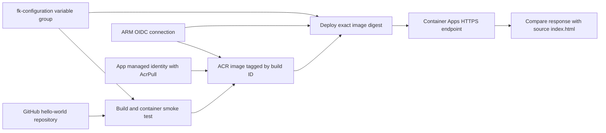

Terraform creates:

- A dedicated Resource Group, Basic ACR with admin authentication disabled, Log Analytics workspace, Consumption Container Apps environment and one public application
- An application managed identity with `AcrPull` scoped to the registry
- An Azure DevOps project, GitHub source connection, ARM OIDC connection and `fk-configuration` variable group through `terraform-az-fk-devops`
- Pipeline identity permissions: `AcrPush` on the registry, `Contributor` on the individual application, and `Reader` on the Resource Group
- A YAML pipeline pointer and individual endpoint/group authorizations through this repository’s root module

The variable group contains only nonsecret values: environment, registry name/server, Resource Group name, application name and HTTPS URL. YAML explicitly references `fk-configuration`; Terraform attachment alone does not inject its variables. `allow_access = false` avoids an all-pipeline permission grant. Azure DevOps treats nonsecret variables differently from protected secret variables.

The pipeline reads **`azure-pipelines-cicd.yml` on `master` in [foggykitchen-hello-world](https://github.com/foggykitchen/foggykitchen-hello-world)**. The local `azure-pipelines.yml` is a reference copy. Example 01 keeps its separate `azure-pipelines.yml` in that source repository.

### Image ownership

The Container Apps dependency is pinned to [v0.3.0](https://github.com/foggykitchen/terraform-az-fk-container-apps/releases/tag/v0.3.0), commit `dca384858e67fc676ab1ace3a48d0658e09d8c9c`, with `deployment_managed_by_pipeline = true`. Terraform creates a public bootstrap image first. The successful pipeline then replaces it with the tested application digest. Terraform ignores subsequent image changes while retaining ownership of runtime configuration. The bootstrap page is not evidence of a successful application deployment.

Both YAML stages use `AzureCLI@2` with `fk-azure-oidc`. No Azure client secret or ACR admin password is required. Build runs a local container test before pushing; Deploy runs only after Build succeeds, receives its digest through a stage output, updates the `hello` container and compares the HTTPS response with the checked-out `src/index.html`.

---

## 🎯 Why this example exists

Example 01 proves container CI and archive publication. Example 02 proves CI/CD, runtime OIDC authentication, ACR push/pull authorization, shared configuration consumption and deployment of the exact tested image.

This is a single-environment deployment example. Approval gates, promotion across environments, canary routing and automatic rollback are future YAML workflow concerns. CI and PR triggers are disabled to avoid unexpected billable deployments; queue a run manually after provisioning.

---

## 🚀 Deployment Steps

### Prerequisites

- The existing Azure DevOps organization, Azure subscription and Entra tenant
- Bootstrap Azure authentication with rights to create the resources, Entra identities and scoped role assignments
- Azure DevOps rights to create the project, service connections, variable group and pipeline permissions
- A GitHub source PAT supplied externally through `AZDO_GITHUB_SERVICE_CONNECTION_PAT`
- The CI/CD YAML committed to the application repository before pipeline creation
- Available Microsoft-hosted parallel-job capacity

Provider pins are AzureRM `4.81.0`, AzureAD `3.10.0` and AzureDevOps `1.16.0`. All module sources are pinned to reviewed commits. The upstream DevOps dependency is its v0.2.0 commit. Source authentication and Azure workload authentication are separate connections. The GitHub PAT is retained in Terraform state; protect state and never commit it.

### Stage 1 — Configure and validate

From this example directory:

```bash
cp terraform.tfvars.example terraform.tfvars
# Replace the nonsecret organization, subscription and tenant placeholders.
tofu fmt -check
tofu init -backend=false
tofu validate
```

Keep this example’s state separate from Example 01. The default Resource Group name is `foggykitchen-pipeline-02-rg`; do not reuse a group managed by another state. If using the shared Azure tfvars file, explicitly override its Resource Group name for this example.

### Stage 2 — Provision infrastructure

```bash
tofu plan
tofu apply
```

Review the complete plan. The module suppresses an automatic first pipeline run so infrastructure and individual permissions are created first. Azure RBAC and federated credential propagation can take additional time after apply.

### Stage 3 — Run CI/CD

Open the `fk-pipeline-02` project, select its pipeline and choose **Run pipeline** on `master`. Check both **Build** and **Deploy** stages. The build publishes its image to ACR and an `IMAGE_METADATA` Pipeline Artifact with digest, source commit and environment. The image itself lives in ACR, not the Azure DevOps Artifacts feed.

After Deploy succeeds, open the `application_url` output. Confirm that the active revision uses the digest recorded by the build. A successful HTTP response alone is insufficient: the pipeline also checks its content against the application source.

---

## 🖼️ Azure DevOps and Azure Portal View

The following screenshots record the successful CI/CD lab on October 14, 2026.

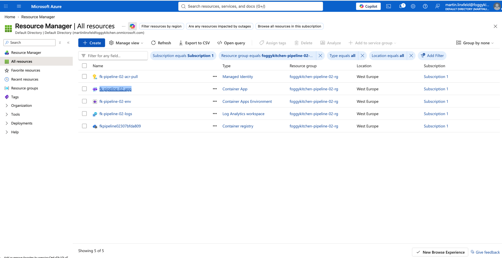

*Figure 1. Azure resources filtered to foggykitchen-pipeline-02-rg: managed identity, Container App, environment, Log Analytics workspace and ACR.*

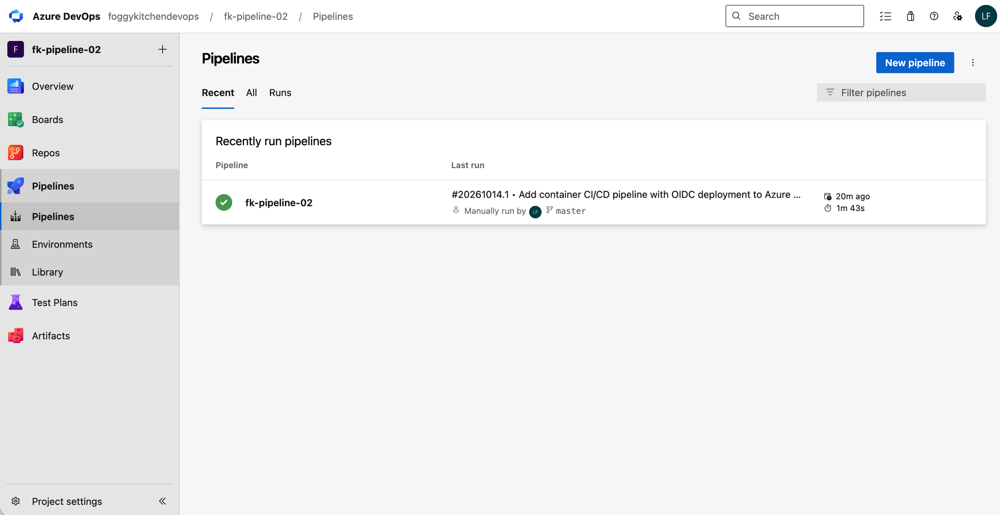

*Figure 2. Azure DevOps Pipelines overview showing fk-pipeline-02 and its successful manual run on master.*

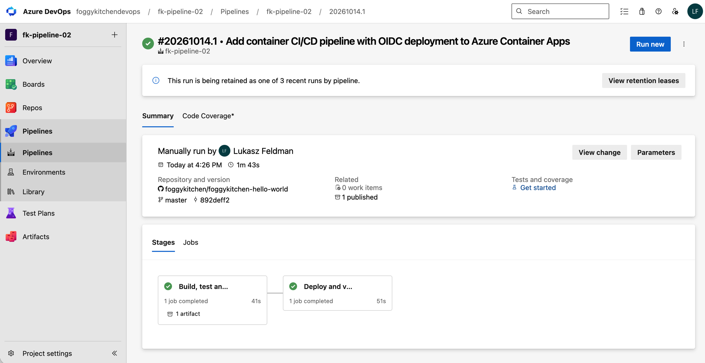

*Figure 3. Successful run #20261014.1 (build ID 5), showing completed Build and Deploy stages and one published artifact.*

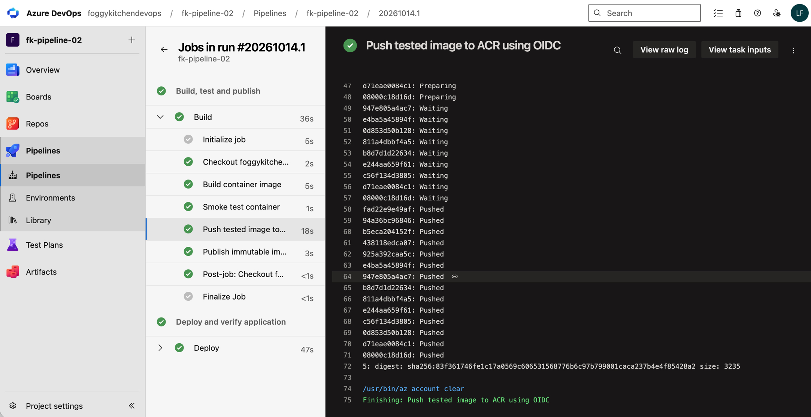

*Figure 4. Successful image build, container smoke test, OIDC-authenticated ACR push and metadata publication. The push log records the image digest.*

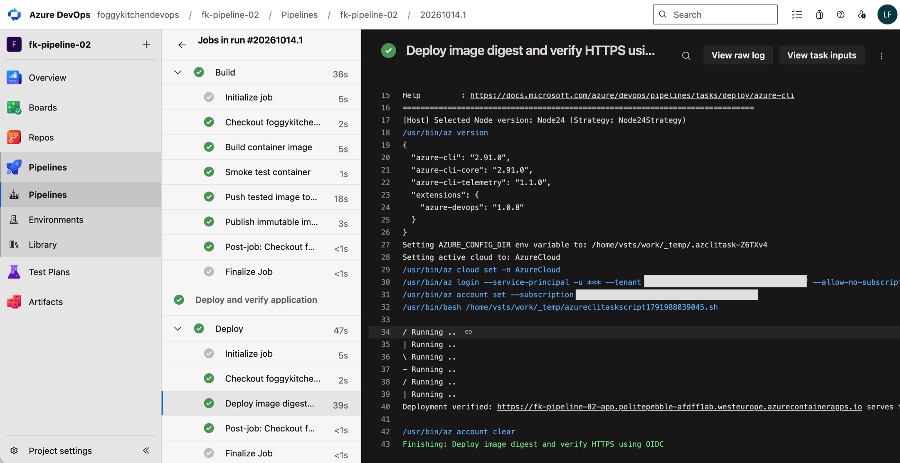

*Figure 5. Successful deployment and HTTPS verification through the ARM OIDC connection. The log confirms application content verification.*

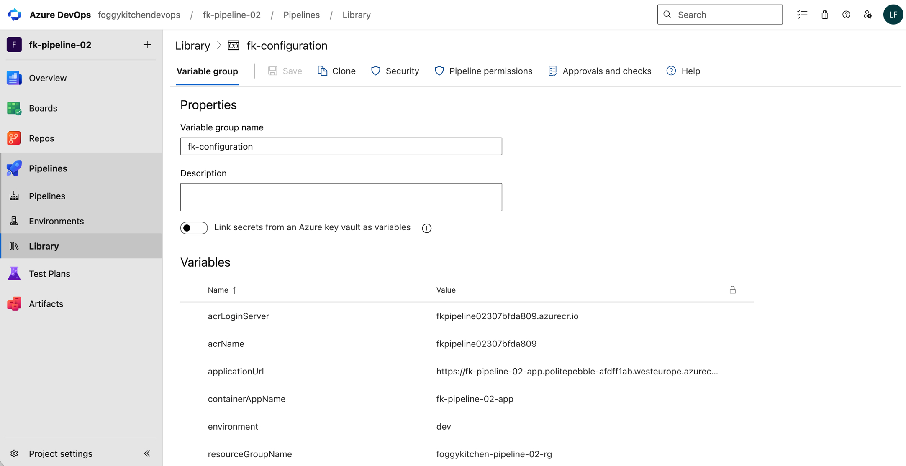

*Figure 6. Nonsecret fk-configuration variables supplying registry, application, Resource Group and environment values to YAML.*

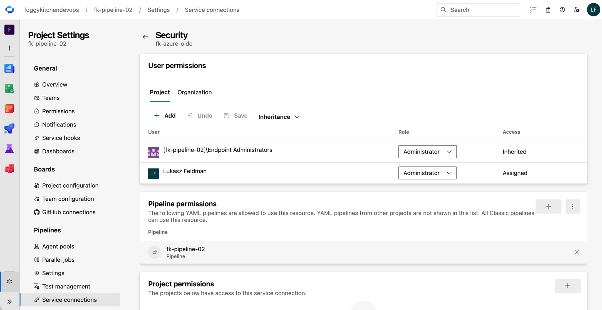

*Figure 7. Individual permission allowing fk-pipeline-02 to use the fk-azure-oidc ARM service connection.*

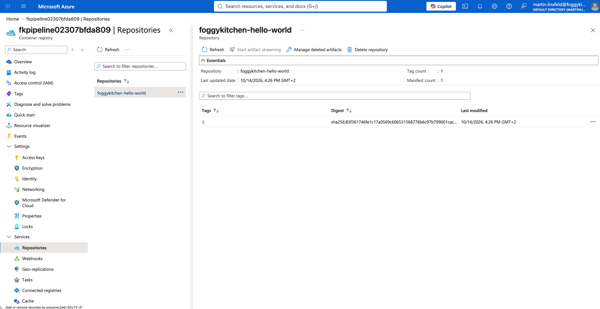

*Figure 8. ACR repository foggykitchen-hello-world containing build tag 5 and its displayed image digest.*

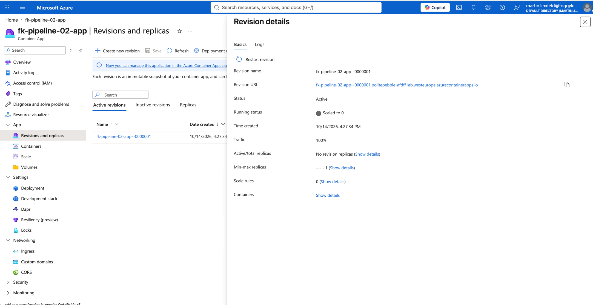

*Figure 9. Details of active revision fk-pipeline-02-app--0000001 with 100% traffic allocation, scaled to zero at capture time.*

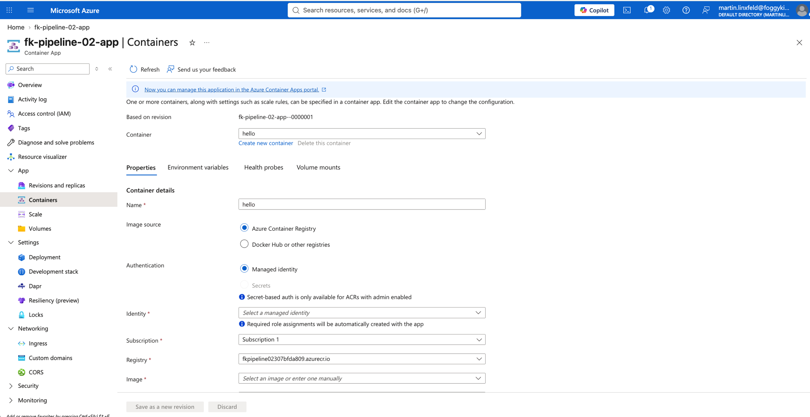

*Figure 10. Container configuration view for hello, showing its revision, registry and managed-identity authentication option. This view does not display the selected image digest or identity.*

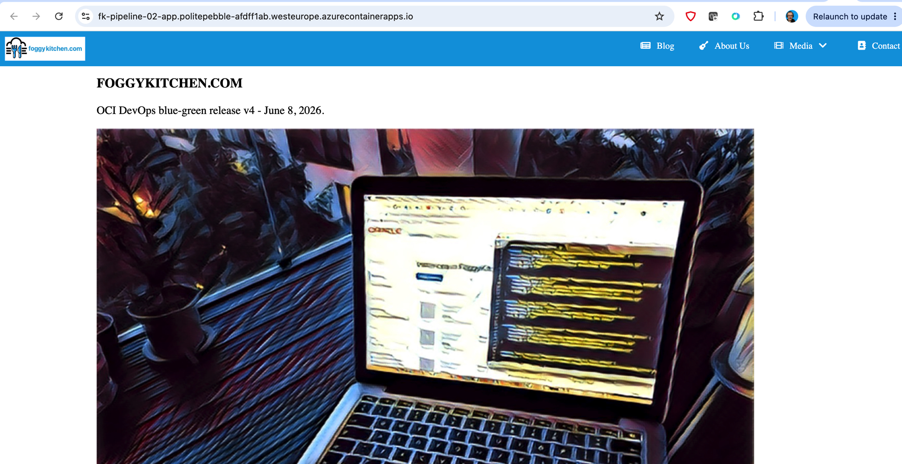

*Figure 11. The hello-world application served through its Azure Container Apps hostname. The OCI release wording belongs to the shared application source.*

---

## ✅ Test Results

Static verification completed on **October 14, 2026** with OpenTofu **1.11.6**:

| Check | Result |
|---|---|
| Root and both examples: `tofu fmt -check` | Passed |
| Root and both examples: `tofu init -backend=false` | Passed |
| Root and both examples: `tofu validate` | Passed |
| CI/CD YAML parsing and Build → Deploy ordering | Passed |
| Embedded Bash syntax checks | Passed |

Live verification completed on **October 14, 2026**:

| Check | Result |
|---|---|
| Provisioning | 21 resources created across the initial and retry apply |
| [Pipeline run #5](https://dev.azure.com/foggykitchendevops/fk-pipeline-02/_build/results?buildId=5) | Succeeded; Build and Deploy stages passed |
| Container build and local HTTP smoke test | Passed |
| Runtime ARM OIDC authentication and ACR push | Passed |
| Deploy exact image digest to Container Apps | Passed |
| Pipeline and independent HTTPS source-content comparison | Passed |
| `IMAGE_METADATA` artifact | Digest, source commit and `environment=dev` verified |
| Post-deployment `tofu plan -detailed-exitcode` | Exit 0: No changes |
| GitHub/ARM/group permissions | Pipeline 2 authorized individually; no all-pipeline grant |

The run used source commit `892deff265ca719a4f05b46755c02bf866be02d2`; execution took approximately 1 minute 44 seconds after about 16 seconds of agent waiting. The deployed image digest is `sha256:83f361746fe1c17a0569c606531568776b6c97b799001caca237b4e4f85428a2`, also present in ACR under build tag `5`. Its active revision is `fk-pipeline-02-app--0000001`.

The initial apply created 13 resources before failing because a Consumption-only environment rejected a named workload profile, and the GitHub PAT was unavailable during apply. Setting `workload_profile_name = null` and supplying the PAT in the apply process environment resolved both errors; the retry created the remaining 8 resources. Keep source credentials available during both plan and apply.

The lab remains deployed. Its HTTPS URL is available through `application_url`; use the hostname for ingress routing rather than the shared environment IP.

---

## 💰 Cost

This example creates billable Azure resources. ACR Basic incurs a standing registry charge. Container Apps uses Consumption with `min_replicas = 0` and `max_replicas = 1`; active requests and compute can incur charges. Log Analytics ingestion can incur charges; the example sets a 0.1 GB daily ingestion quota, which is not a strict spending cap. Azure DevOps hosted agents are subject to the organization’s parallel-job allowance. Delete the lab after testing when it is no longer needed. See [ACR pricing](https://azure.microsoft.com/pricing/details/container-registry/), [Container Apps pricing](https://azure.microsoft.com/pricing/details/container-apps/) and [Azure Monitor pricing](https://azure.microsoft.com/pricing/details/monitor/).

---

## 🧹 Cleanup

```bash
tofu destroy
```

Destroy removes the example’s Azure resources and Azure DevOps project, including pipeline run history and its artifacts. The application repository, organization and subscription remain external. Review project contents before deletion. If ARM connection deletion reports that an already-deleted federated credential still exists, verify its removal and retry after Entra propagation.

---

## 🪪 License

Licensed under the **Universal Permissive License (UPL), Version 1.0**.
See [LICENSE](../../LICENSE) for details.

---

© 2026 [FoggyKitchen.com](https://foggykitchen.com) - Cloud. Code. Clarity.
