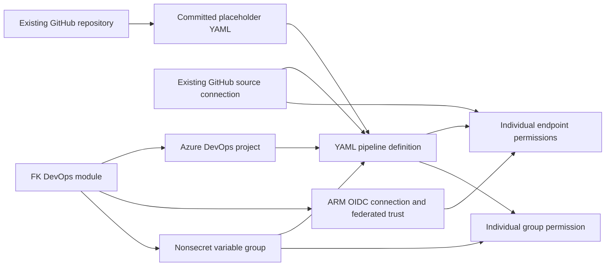

# Example 02: Pipeline with Variable Group Authorization

In this second Azure Pipelines example, we extend the **GitHub-sourced YAML pipeline definition** with **variable-group attachment and individual authorization** using **Terraform / OpenTofu**.

The example composes **terraform-az-fk-devops** with the local pipeline module. Shared project and ARM federation resources are created upstream; an existing GitHub source connection supplies repository access.

---

## 🧭 Architecture Overview

The pipeline definition points at a YAML path on the `main` branch of `foggykitchen/terraform-az-fk-devops-pipeline`. Separate endpoint permissions allow this pipeline to use the GitHub source connection and the upstream ARM OIDC connection.



This example creates:

- One Azure DevOps project through `terraform-az-fk-devops`
- One Entra application/service principal, ARM WIF connection and federated credential through the upstream module
- One YAML pipeline definition through the local `terraform-az-fk-devops-pipeline` module
- Individual pipeline permissions for the existing GitHub source endpoint and upstream ARM endpoint
- One nonsecret `fk-configuration` variable group through the upstream module
- Definition-level group attachment and individual `variablegroup` authorization

The upstream module creates `fk-configuration` with `environment = "dev"` and `allow_access = false`. Its logical `configuration` ID is passed to `variable_group_ids`. The pipeline module attaches the group to the definition and creates a separate individual permission. Nonsecret variables are not protected by the same checks as secret variables; this example demonstrates the permission resource without introducing secret fixtures.

The placeholder does not consume the group. A real YAML pipeline must reference the group by name in caller-owned content; definition metadata and authorization do not generate that YAML declaration.

The organization, subscription, GitHub repository and GitHub source endpoint already exist. No source repository, Azure role assignment, networking or deployment target is created.

**Stages, jobs, steps and trigger logic remain in YAML.** The committed `azure-pipelines.yml` is only a placeholder with CI and PR triggers disabled and a single echo step. It contains no OpenTofu plan/apply or OIDC login logic and does not use the ARM connection.

---

## 🎯 Why this example exists

This example introduces **shared pipeline configuration and explicit resource permissions** after the minimal definition from Example 01.

This example focuses on:

- Adding shared configuration through the upstream module
- Keeping `allow_access = false` on the variable group
- Separating definition attachment from permission to use a protected resource
- Passing `module.devops.variable_group_ids` directly into the pipeline module
- Keeping group consumption in the caller-owned YAML

---

## 🚀 Deployment Steps

### Prerequisites

- An existing Azure DevOps organization and subscription
- Rights to create projects, ARM connections and pipeline definitions, and to manage individual pipeline resource permissions
- Entra rights to create/manage applications, service principals and federated credentials
- Bootstrap authentication configured externally for the AzureDevOps and AzureAD providers
- A GitHub source connection in this example's project with access to the referenced repository
- The placeholder YAML published on the repository's selected remote branch

Copy `terraform.tfvars.example` to ignored `terraform.tfvars` and replace the nonsecret placeholder identifiers. Keep provider credentials outside HCL and tfvars. The GitHub endpoint ID and ARM endpoint ID identify different resources.

### Stage 1 — Prepare the project and source access

For a fresh environment, provision the upstream resources declared in `devops.tf` as a separate bootstrap stage before registering the pipeline. The project name is `fk-pipeline-02`. Register a GitHub App/service connection in that project through an independently managed setup, then set `github_service_connection_id` to its ID. A connection from another project is not a substitute.

The configuration requires this staged prerequisite; it does not create a GitHub endpoint automatically. When upstream resources are already managed in this example's state, retain that ownership. Avoid creating a second project with the same name in a separate state without reconciling ownership.

Publish the referenced `examples/02_pipeline_with_variable_group_authorization/azure-pipelines.yml` on the remote `main` branch. A local file or local commit alone does not make the path available to Azure DevOps.

### Stage 2 — Validate the pipeline configuration

From this example directory:

```bash
cp terraform.tfvars.example terraform.tfvars
# Replace the nonsecret placeholder identifiers before deployment.
tofu init -backend=false
tofu fmt -check
tofu validate
```

`devops.tf` composes the upstream module at a reviewed commit. `pipeline.tf` uses the local root module source `../..`. `providers.tf`, `variables.tf` and `outputs.tf` provide the example wrapper. The pipeline definition suppresses its initial automatic run.

Provisioning is a separate operator action after the prerequisites are ready and the configuration has been reviewed. No deployment was performed during this example's verification. The ARM connection grants no Azure RBAC; compose the dedicated RBAC module externally when a future workload needs subscription access.

---

## 🖼️ Azure DevOps Portal View

No deployment screenshots have been collected for this example.

After an authorized deployment, inspect the project’s **Pipelines** view for `fk-pipeline-02`, its GitHub repository, selected branch and YAML path. Inspect **Project settings → Service connections → Pipeline permissions** for both endpoint grants. Inspect **Pipelines → Library → fk-configuration → Pipeline permissions** for the group grant.

Portal configuration evidence should be recorded separately from a successful pipeline run or OIDC token exchange.

---

## ✅ Test Results

Static verification completed on **October 14, 2026** with OpenTofu **1.11.6**:

| Check | Result |
|---|---|
| `tofu fmt -check` | Passed |
| `tofu init -backend=false` | Passed |
| `tofu validate` | Passed |
| Placeholder YAML syntax | Passed |

No plan, apply or pipeline execution was performed. These checks validate the configuration and provider schema; they do not verify remote file availability, organization permissions or runtime OIDC authentication.

The example outputs expose `project_id`, `service_connection_id` and `pipeline_id`. The pipeline ID output waits for its endpoint and variable-group permission resources. This establishes dependency ordering, not a guarantee of runtime readiness.

---

## 🧹 Cleanup

Static validation created no Azure or Azure DevOps resources, so no cloud cleanup was required.

After a future deployment, review project contents and source-connection ownership before destroying the example. The configuration manages the project, Entra identity, ARM connection, federated trust, pipeline definition and its individual permissions, plus the upstream variable group. Project deletion can also remove contents added independently, including the GitHub source endpoint. The GitHub repository, Azure DevOps organization and Azure subscription remain externally managed.

---

## 🪪 License

Licensed under the **Universal Permissive License (UPL), Version 1.0**.
See [LICENSE](../../LICENSE) for details.

---

© 2026 [FoggyKitchen.com](https://foggykitchen.com) - Cloud. Code. Clarity.
